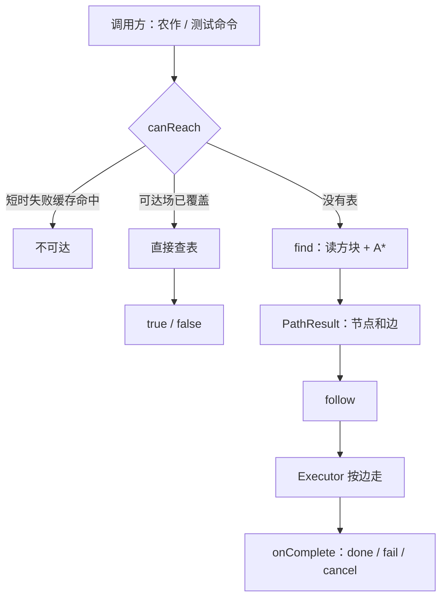
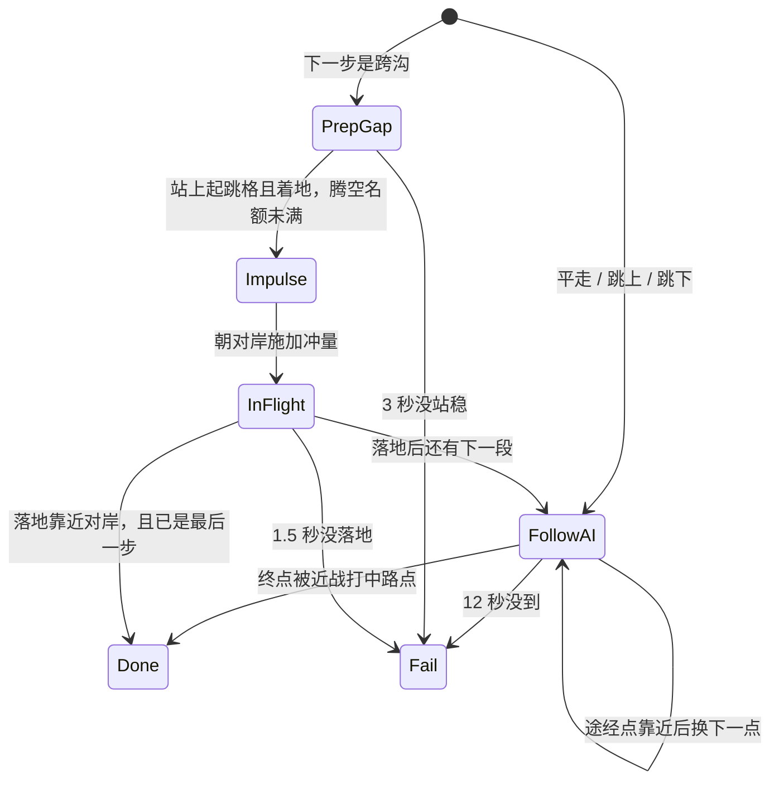

# 女仆寻路

脚本在方块上建一张「能站的格子图」，用 A* 找出一条路，再让女仆跟着走。平地、跳上一格、跳下、跨沟是四种走法。包外统一走 `EntityMaid.Path`，实现都在 `TouHouLittleMaid_BP/typescripts/src/maid/path`。

当前生产用法是农作：扫描作物格 → 判断能不能走到 → `Path.follow` → 走到后再收割或补种。

## 先记住三个高度

路径上的一个点叫 **支撑格**，坐标是脚底下那块方块，不是脚的位置。

| 名字 | 高度 | 例子（支撑在 y=63） |
| --- | --- | --- |
| 支撑格 | `y` | 耕地、石头、关着的底装活板门 |
| 脚位 | `y + 1` 的格心 | `(x+0.5, 64, z+0.5)` |
| 头位 | `y + 2` | 用来判断站直会不会顶到方块 |

起点用女仆当前脚位反推支撑格：先看脚下一格，脚陷进耕地时再看脚所在格本身。终点先当成支撑格试，不行再当成脚位、改用它下面那一格。农作把作物方块坐标传进来时，实际站的是下面的耕地。

## 文件各管什么

| 文件 | 职责 |
| --- | --- |
| `blockPredicates.ts` | 这一格能不能穿过、能不能当地板、是不是危险 |
| `StandableCache.ts` | 把搜索范围内的方块读进内存，避免重复 `getBlock` |
| `SharedStandable.ts` | 同一片区域几秒内共用一份方块缓存 |
| `edges.ts` | 从一个站立点展开四种边 |
| `AStar.ts` | 在边上搜出一条到终点的路 |
| `ReachabilityField.ts` | 预先算出「哪些站立点能到达某个目标」，给批量筛选用 |
| `UnreachableCache.ts` | 刚走失败的终点，短时间不再重试 |
| `Path.ts` | 对外的 `find` / `canReach` / `follow` / `cancel` |
| `Executor.ts` | 把规划好的边变成女仆的实际移动 |
| `ImpulseTable.ts` | 跨沟时用多大冲量 |
| `ReachViz.ts` | 调试粒子：可达、可站、刚失败的终点 |
| `constants.ts` | 搜索范围、下落高度、边代价、A* 上限 |
| `types.ts` | 节点、边、寻路结果、跟随结束回调 |
| `main.ts` | 本目录对外再导出 |

门面在 `src/maid/facets/Path.ts`，只是把上面的 `Path` 挂到 `EntityMaid.Path`。

## 整体怎么跑



一次完整跟随分两段：

1. **规划**：在搜索箱里标出能站的格子，连上边，A* 得到节点序列和边序列。
2. **执行**：平路、跳上、跳下交给原版追逐（Seek + 路点实体）；跨沟在起跳格站稳后施加冲量，空中再微调落点。

`canReach` 只回答能不能到，不移动女仆。`follow` 会先做一次 `find`，规划成功才开始走。

## 什么样的格子能站

一个支撑格能当路径节点，要同时满足：

- 脚下这块的顶面能整格站人（`support`）
- 脚位和头位都能穿过去（`passable`）
- 脚下、脚位、头位都不是危险格（`hazard`）

默认把水当成危险，不能站在水上。岩浆、火、岩浆块同样不能站。

能当整格地板的包括实心方块、玻璃、地毯、耕地，以及关闭且装在底部的活板门。空气、液体、植物、火把、告示牌、拉杆、压力板不能当地板。

栅栏和墙整格不当地板（栅栏顶上能不能站，首版不做）。楼梯、梯子、脚手架、打开的活板门也不当普通站立点。树叶不能当地板。

世界外或区块没加载的格子，当成既不能穿也不能站，寻路不会因此抛错。

## 四种走法

从一个站立点只朝东南西北四格看，不做斜向走。邻居必须落在本次搜索箱里。

| 边 | 什么时候生成 | 代价 |
| --- | --- | --- |
| `Walk` | 旁边同一高度也能站 | 1 |
| `Jump1` | 旁边高一格也能站，并且起跳处头顶再多一格是空的 | 1.3 |
| `Fall` | 旁边向下 1～3 格有落点；中间不能先踩到更近的落点；下落路径身体要过得去 | 1 + 0.3 × 下落格数 |
| `SprintGap` | 同一方向跨 2～4 格到对岸；高度差只允许 -1、0、+1；沟中间不能有可站的踏脚 | 7 |

跨沟每个方向只留**最近的一条**。同样距离时，优先平跳，其次低一格，最后高一格。向上跨沟同样要求起跳处头顶有空。

代价上跨沟最贵，所以有平路或小跳时会优先走那些边。`includeGap: false` 可以关掉跨沟。

## 怎么找出整条路

`find` / `findFromMaid` 的步骤：

1. 把起点脚位、终点坐标解析成支撑格。解析失败直接返回 `bad_start` 或 `bad_goal`。
2. 用起点和终点的包围盒，水平再扩 `searchH`（默认 16）、竖直再扩 `searchV`（默认 4），得到搜索箱，并把 Y 钳进当前维度高度。
3. 向共享缓存租这一箱的方块数据。3 秒内同一箱、同一种「水是否危险」设置会复用，不再整箱重读。
4. 再用缓存确认起点、终点仍然能站。
5. 跑 A*。展开超过 2000 个节点返回 `max_expand`；墙钟超过 50ms 返回 `timeout`；开放集空了返回 `unreachable`。
6. 成功时 `PathResult.ok = true`，`nodes` 是从起点到终点的支撑格，`edges` 是连接它们的边。起点和终点是同一格时，`nodes` 只有起点，`edges` 为空，也算成功。

A* 用「水平曼哈顿 + 高度差」决定先展开哪一格，让搜索朝终点走。平走和跨沟的代价不低于这个估计；跳上和跳下的真实代价更低，所以得到的是一条能走的路，不保证是绝对最短。

`findNodes` 给已经解析好的两个支撑格用，适合批量检测时少做一次脚位换算。

## 少做重复计算的三张表

### 共享方块缓存

`acquireSharedStandable` 按「维度 + 箱子范围 + 水是否危险」做钥匙。命中就续期，不重新 `warmBox`。租约用完要 `release`，引用归零且过期后才丢掉。地形变了可以 `invalidateSharedStandable`。

### 可达场

农作一次可能有很多作物格。若每个都单独 A*，开销大。`ensureReachabilityField` 在一块 ROI 里：

1. 列出箱内所有能站的格子（最多 4000 个）。
2. 用和 A* 同一套 `expandEdges` 建成「谁能走到谁」的反向表。
3. 从每个目标反向搜索，得到「哪些站立点能到达这个目标」。

之后 `canReach` 先查这张表。表能回答就直接返回；表没覆盖这个起点或目标时，退回完整 A*。场默认活 10 秒。`ignoreReachField: true` 强制走 A*，用来抽查。

跟随失败时会丢掉这个终点的可达集合，避免一张过期的「能到」继续让女仆去撞墙。

ROI 的划法与搜索箱相同：`buildRoiAround(锚点, 水平半径, 竖直半高)`。农作的锚点是女仆脚下支撑格，水平半径至少 16，扫描范围更大时用扫描范围。

### 短时不可达

跟随失败（超时、冲量失败、女仆失效等）会把「这个女仆 + 这个终点」记 30 秒。这段时间 `canReach` 直接返回 false。`cancel` 不记。`ignoreBan: true` 可以跳过这条缓存。

## 规划成功之后怎么走

`follow` 规划成功后把边交给 `Executor`。同一女仆已有跟随会先取消旧的，再开新的。Seek 名额分配失败时返回 `follow_start_fail`，女仆不动。

边会先收成更少的执行步，规划结果本身不变：

- 连续平走每 16 格留一个途经点，这一段的最后一格必留。
- 跳上、跳下每一步都留。
- 跨沟单独一步。
- 只有整条路最后一个追逐点是终点，其余都是途经点。

执行器每 2 tick 推进一步，同一时间最多 4 个女仆处于跨沟腾空。



途经点怎么算到了：女仆脚位离该格脚位，水平不超过 0.75、竖直不超过 1.6。终点不靠这个距离，靠女仆近战打中**本段路自己的**路点实体。这样终点可以对准作物格中心，而不是贴在耕地顶面上。

路点实体一次跟随只生成一个，换点时传送，不反复创建。途经点放在眼睛高度，终点放在支撑格上方一格的中心（农作就是作物方块中心）。跨沟的路点放在对岸脚位沿跳跃方向再偏出 0.3、并抬高 1.5，避免和落地后的身体叠在一起。

跨沟的细节：

1. 先用追逐走到起跳格，着地后再跳。
2. 竖直冲量按「跨度 2/3/4 × 高度差 -1/0/1」查表。
3. 水平冲量按当前脚位到对岸格心的真实距离反解，不是写死的桶。
4. 腾空中若预计落点和格心的曼哈顿距离超过 0.1，就补一次水平冲量。
5. 落地且靠近对岸后清掉水平速度，避免滑出垫子，再进入下一步。

会话结束时卸追逐、解锁移速、删路点，并在下一 tick 调用 `onComplete`。下一 tick 是为了避免回调里立刻再给同一女仆开新跟随，和当前这一拍打架。

回调里看 `reason`：

| reason | 含义 | 会不会短时拉黑终点 |
| --- | --- | --- |
| `done` | 走完，或一开始就在终点（`detail` 为 `empty_path`） | 否 |
| `fail` | 超时、冲量失败、女仆失效等，细因在 `detail` | 是，30 秒 |
| `cancel` | `Path.cancel`，或新的 `follow` 顶掉旧会话 | 否 |

`detail` 常见值：`done`、`empty_path`、`cancel`、`ai_timeout`、`prep_timeout`、`flight_timeout`、`maid_invalid`、`spawn_marker`、`seek_mount`、`no_impulse`。

`isFollowing` 在会话还在时为 true。`onComplete` 触发时会话已经拆除，所以回调里它是 false。

## 怎么用

### 日常只需要这几个方法

```typescript
import { EntityMaid } from "../maid/EntityMaid";

// 只问能不能到。dest 可以是脚位，也可以是支撑格。
const ok = EntityMaid.Path.canReach(maid, dest);

// 规划并开始走。成功时 result.ok 为 true，边在 result.edges。
const result = EntityMaid.Path.follow(maid, dest, {
  onComplete: (info) => {
    if (info.reason === "done") {
      // 已经站到终点附近，可以交互方块
    }
  },
});

EntityMaid.Path.cancel(maid);
EntityMaid.Path.isFollowing(maid);
```

只要路线、先不走：

```typescript
const planned = EntityMaid.Path.findFromMaid(maid, dest);
if (planned.ok) {
  EntityMaid.Path.followResult(maid, planned, { onComplete });
}
```

`dest` 用整数方块坐标。传支撑格或传脚位都可以，`standNodeFromDest` 会两种都试。

可选参数（规划与跟随共用，除了 `onComplete` 只对跟随有效）：

| 字段 | 默认 | 作用 |
| --- | --- | --- |
| `searchH` / `searchV` | 16 / 4 | 搜索箱在起终点包围盒之外再扩多少 |
| `waterAsHazard` | `true` | 水能不能站 |
| `includeGap` | `true` | 是否允许跨沟 |
| `maxFall` | 3 | 最多向下几格 |
| `gapMin` / `gapMax` | 2 / 4 | 跨沟距离 |
| `maxExpand` / `maxMs` | 2000 / 50 | A* 节点上限和墙钟上限 |
| `ignoreReachField` | `false` | `canReach` 是否跳过可达场 |
| `ignoreBan` | `false` | `canReach` 是否忽略 30 秒失败记录 |
| `onComplete` | 无 | 跟随结束回调 |

### 农作里的用法

`Farm.assignNext` 是生产路径，顺序固定：

1. 女仆已经在跟随时，不再派新目标。
2. 以脚下为锚点建 ROI，把候选作物下方的耕地登记成可达场目标。
3. 按离女仆的距离从近到远试。格子被别的女仆占了就跳过。
4. `canReach` 为 false 就换下一格。
5. 已经站在旁边就直接收割或补种，不再寻路。
6. 否则锁定这一格，`Path.follow` 把作物方块坐标当终点。
7. `onComplete` 里若 `reason === "done"` 才对那一格动手；失败只释放锁定。`cancel` 不自动派下一格，避免模式切换时又跑出去。

回调里会核对自己记下的任务坐标。旧跟随被新跟随顶掉时会收到 `cancel`，这时任务已经被换掉，直接忽略，避免清掉新任务。

### 调试

游戏内（永久回归入口，不要卸掉）：

```text
/scriptevent thlm:test path_go
/scriptevent thlm:test path_cancel
/scriptevent thlm:test path_status
/scriptevent thlm:test path_help
```

`path_go` 让离你最近的女仆走向你看的方块。控制台搜：

- `PATHGO|` 规划摘要（成不成功、边的种类）
- `PATHDONE|` 结束原因
- `PATHGAP|` 跨沟起跳和落地

世界设置里有两个开关，默认关：

- **显示路点**：跟随中的途经点红色、终点绿色；另外刷可达场（青绿）、能站但没进可达场的格子（黄）、刚失败的终点（品红）。开启后新建的路点实体也可看见。
- **显示轨迹**：跟随期间在女仆脚边留蓝色点，大约 10 秒。

## 规划失败时 result.reason

| reason | 含义 |
| --- | --- |
| `bad_start` | 女仆脚下不能站 |
| `bad_goal` | 终点不能站 |
| `bad_bounds` | 搜索箱的 Y 被维度高度钳空了 |
| `timeout` | A* 超过 50ms |
| `max_expand` | 展开节点超过 2000 |
| `unreachable` | 搜索箱里没有路 |
| `empty_path` | 规划成功但没有终点节点（异常） |
| `follow_start_fail` | 路找到了，但 Seek 池满或女仆已失效，没开始走 |

## 首版不做的事

- 斜着走。
- 栅栏顶、楼梯、梯子、脚手架当普通落脚点。
- 游泳、爬梯、开门。
- 搜索箱以外的绕路。箱子是起终点包围盒再加水平 16、竖直 4；竖向落差大或要绕很远时会报不可达。
- 可达场和方块缓存会过期，但方块在有效期内被挖掉或放上时，要等 TTL，或由调用方 `invalidateReachabilityField`。跟随失败只会丢掉对应的那一个目标。
