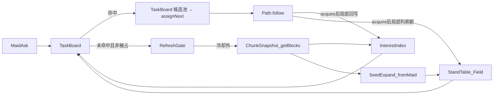

# 任务调度大改

## 基本任务

1、任务调度应该以可达场的视角进行。女仆在获取目标时，不应每次都遍历方块，而是让落脚点表、可达场自行扩展范围、更新方块信息和搜索目标。在女仆索要目标时直接从缓存中查找。
2、充分发挥 getBlocks 的性能优势：先排除空气并分组填 flags 快照，再按需 `getBlock`；落脚点表不按 16×16 栅格全建，而是从触发女仆坐标做可达外扩（读快照），压缩建点/连边成本。

----

## 现状与痛点

### 调度入口

| 入口 | 频率 | 做什么 |
| --- | --- | --- |
| `MaidScheduleEvents.onTimer` → `MaidTarget.stepEvent` | 每步（约 3s） | 各工作 `onSchedulePulse`：卡住 job 兜底、空闲时 `collectTasks(claimRange)` 再派 |
| `MaidScheduleEvents.onTimer` → `MaidTarget.search(maid, 15)` | `healStep % 3`（约 9s） | 各工作 `search`：过 `SpeedController` 闸门后 `collectTasks` → `assignNext` |
| `onFollowComplete` | 每次跟随结束 | 队列空时再 `collectTasks` 续派 |

### 扫描开销

每次选目标都是**按女仆各自**重扫方块，同一块田多个女仆会重复扫描：

| 工作 | 扫描方式 | 每格开销 |
| --- | --- | --- |
| Farm | 按列 `getBlocks`（土地 + 成熟作物 permutation） | 每个命中位置再 `getBlock` 1～2 次（土地、上方作物） |
| 甘蔗 | 螺旋逐列 `getBlock` | 每列 3～6 次 |
| 瓜 | 螺旋逐列找瓜蒂 `getBlock` | 每列最多 3 次；读 `growth`、`facing_direction` 推瓜坐标 |
| 可可 | 螺旋逐列 `getBlock` | 每列 6 次（脚位 +4 到 -1） |

节流靠 `SpeedController` 的 `target_lack` 慢扫描：按女仆计数，与地形是否变化无关。空田里女仆照样定期全量扫描。

### 可达场只建不补

`StandField`：

- 落脚点只在 `scanChunk` → `createLeaf` 时新建；已扫完的层不再补新落脚点。
- 已有落脚点只在出发找路扩展到它时 `rereadLeaf`，只能删点、删边。
- 区块要闲置 `FIELD_CHUNK_IDLE_MS`（60s）**且**不在任何女仆活动圈内才 `discardIdle`；女仆在田里干活时区块永远不重建。

后果（瓜类堵路）：瓜长出后原地面落脚点失效，瓜顶新落脚点不入表；瓜被收后瓜顶落脚点失效，瓜下地面重新可站却不入表。场与地形长期对不上，表现为认领 `paused`/`unknown` 抖动、走廊被当成墙。

### 逐格读方块

`StandableCache.getFlags` 逐格 `getBlock`；建一个落脚点读支撑、脚、头 3 格，`isSunkSupportBlock` 每次都 `getBlock` 不走缓存。一个 16×16 区块建 3 层：同一缓存内去重后读 5 个高度约 1280 次，另加 `isSunkSupportBlock` 每格约 768 次，合计约 2000 次 `getBlock`。

----

## 总体架构

三层：

| 层 | 内容 | 生命周期 |
| --- | --- | --- |
| 区块缓存层 | **ChunkSnapshot**（flags / 分组）、落脚点表、可达场、**兴趣点表** | 快照与兴趣按区块层；落脚点由种子可达外扩写入。按区块卸载。兴趣与场都消费同一份快照，不互相写入对方私有表 |
| 调度层 | **任务板**（TaskBoard）+ 刷新闸门（RefreshGate） | 进程内；女仆索要目标时只查缓存，套用 `cellClaims`、活动圈、同场判定，取最近 N 个 |
| 工作适配层 | Farm / 甘蔗 / 瓜 / 可可 | 只保留：兴趣点判定规则、`acquireAt`、兴趣点 → 落脚点映射。各自 `collectTasks`、`SpeedController` 退场 |



依赖方向：工作适配层只依赖任务板的抽象接口（注册兴趣点规则、`acquireAt`），不直接读落脚点表内部结构；任务板经 `StandField` 的导出函数（`classifyFieldClaim`、`reversiblePathResult` 等）问场，不碰 `DimRec`。`ChunkRec` 不出现 `InterestPoint`；兴趣索引经导出函数问场，用同一套卸载信号自清。

----

## 被区域指导的任务调度

落脚点表和可达场的 **更新条件** 需要改变。在女仆通过任务表找不到新目标（因为有其他女仆占用而找不到的情况除外）时，激活工作范围内 落脚点表等缓存数据 的更新，若这次更新没有找到新目标则等待一段时间再更新一次。两次更新之间需要存在较长的时间间隔（60s，即1200tick）。

### 范围

工作范围 = 女仆**活动圈**（家模式：家框 ±32；跟随：主人脚下 ±32；主人不在：女仆脚下 ±32），即 `activityCircleOf` 的方框。64×64 约 16 个区块（未对齐区块边界时最多 25 个）。getBlocks 优化后大范围处理效率提升，此开销可接受。

### 触发

- 女仆索要目标 → 任务板在缓存里找不到可派项。
- 区分「没有」和「被占」：候选存在但全部被其他女仆 `cellClaims` 占用 → **不触发**刷新，按现有空闲节奏等待。
- 候选存在但全部场不同/走不到（`different` / `unreachable`）→ 视为「没有」，可以触发（地形可能已变）。
- `unready`（快照未就绪，或起点/目标叶子尚未被种子外扩建出）→ 不触发刷新，等预算；`paused` 同理不刷新。

### 节流

- 两次刷新之间至少 **1200 tick**（建议值，改前请示）。
- 冷却按**活动圈覆盖的区块集合**记，不按女仆记：多个女仆在同一块田同时找不到目标时只刷新一次。
- 记录方式建议：每个区块记 `lastRefreshTick`；一次刷新请求只处理冷却外的区块。

### 刷新做什么

对范围内冷却外的区块层做 **快照 diff**（已定方案 A；流程见下文两段扫描）：

1. 重跑 getBlocks → 更新 `ChunkSnapshot`；兴趣点按快照 diff 增删候选。
2. 落脚点：与表里**已有叶子**比对（不是与层内全部可站格栅格比对）：
   - 已有叶子对应格不再可站 → `removeLeaf`；
   - 都在但脏区内邻居变了 → `rereadLeaf`（加边合并 / 删边探测）；
   - 快照里新出现的可站格 → **不立刻整层 `createLeaf`**，而是入维度级种子/frontier，由可达外扩写入（已有叶子邻接的可直接扩到）。
3. 变动的边全部走现有合并与删边探测（P6），场编号不整片重排。
4. 脏区半径 = 8 邻列 ∪ 同轴 `REVERSIBLE_REACH`（`GAP_MAX`），局部列刷新与圈 diff 共用；局部列插队。

范围内还没有快照的层：先快照扫描，再把触发女仆坐标（及圈内其它活跃女仆）投入种子队列外扩；不算「刷新冷却」语义下的 diff，但占同一套预算通道时要限流，避免整圈 `pending` 打成 `unready`。

### 预算

沿用 `budgets.ts` 的「每拍上限、用尽只停这一件」：

- **刷新扫描预算**：每拍最多重扫多少个区块层快照；
- **种子外扩预算**：每拍最多 `createLeaf` / 扩边步数（可与现 `FIELD_BUILD_NODES_PER_TICK` 对齐或分立）；
- 快照用尽只停快照；外扩用尽只停外扩；**不要**为刷完一层吃光 merge/probe 额度。

未做完的层留在刷新队列；冷却从该层快照实际做完时起算（键建议 `dim+cx+cz+y层`）。

----

## 兴趣点表

新增兴趣点索引（InterestIndex）。与落脚点表同级生命周期（随区块卸载），但**不在 `createLeaf` 里顺手挂**：由快照消费者根据已注册规则写入，这样圈内兴趣不依赖女仆是否已把可达场扩到那一格（解决「没建叶子就看不见田」）。

规则仍分两类（实现都读快照，不读 `DimRec` 私有结构）：

+ 与落脚点强相关：farm（土地+作物/空气）、sugar_cane（连续 reeds + 支撑）——`standKeys` 问场导出函数，缺叶时当 `unready` 或跳过该键；
+ 不必落在落脚点子集：可可（周围落脚）、瓜（四邻贴蒂即可，不查朝向）。

### 数据模型

```
InterestPoint {
  kind: 规则 id 字符串（文档举例 farm_harvest / farm_plant / …；实现用注册表，勿闭集写死核心）
  pos: 动手的方块坐标（作物格 / 要砍的甘蔗节 / 瓜块 / 可可）
  standKeys: 支撑格坐标键（1～多个；必须是支撑格，不是脚位/动手格）
  extra?: 可可 direction、补种作物 typeId 等
}
```

- 存放：兴趣索引与区块同生共死；`discardIdle` 时经卸载信号自清，不读 `DimRec`。
- 表里**只存 candidate**；不要落盘全局 `ready`（`farm_plant` 就绪依赖女仆背包）。
- 归属层：按 `pos` 所在区块与高度记；`standKeys` 可以跨区块，缺叶时查询容错。
- 认领：通过 `standKeys` 问场得 `fieldId`；无叶则 `unready` / 继续种子外扩。

### 候选与就绪分两段

| 段 | 存什么 | 何时更新 |
| --- | --- | --- |
| 候选 candidate | 位置类型满足：作物格、空土地、甘蔗柱、瓜块、可可 | 快照扫描、刷新 diff、`acquire` 后局部回写 |
| 就绪（查询视图） | 候选里此刻可动手的：成熟 permutation、背包种子等 | **查询时批量确认**，不写回共享表 |

就绪确认：一批候选做成 `ListBlockVolume`，`getBlocks(list, { includePermutations })` 筛就绪；按距离前缀 >N 再确认，同圈可共用。作物长熟只改 permutation，**无需为等熟重扫地形**。

### 各作物规则

| kind | 候选判定 | 落脚点 | 就绪判定 |
| --- | --- | --- | --- |
| farm_harvest | 支撑在土地名单中，上方是作物（`FarmBlocks`） | 作物格下方支撑（与现 `goalStandOfTask` 一致） | `includePermutations` = `FarmBlocks.getCorpPermutations()` |
| farm_plant | 支撑在土地名单，上方空气 | 同上 | 查询时按女仆背包、`plantCooldown`、`landHasSeed` 过滤 |
| sugar_cane | 支撑上方连续 ≥2 节 `reeds`；动手为第 2 节（`standDrop: 2`） | 认落脚点表支撑，不认「土」typeId | 候选即就绪；长高靠 type 变化 + diff |
| melon | 瓜块四邻紧贴对应瓜蒂 | 四邻可站（高低差 1）；瓜顶是否纳入单独验收 | 候选即就绪 |
| cocoa | `cocoa` | 原木外侧四邻与下方可达落脚（不要求正下方） | 一次 `includePermutations` 放入四个朝向 age=2；direction 在 acquire 时读（`Cocoa.acquireAt` 仍会 getBlock 核 age） |

说明：

- **瓜不查朝向**（已确认接受）：未成熟蒂旁成熟瓜也会入表；勿后门加 `growth===7`。
- **瓜顶落脚点**：相对现状是新增行为，P8d 单独验收；Arrive 无朝向则可不收瓜顶。
- **沉陷**：`isSunkSupport` 只对 farmland；土地名单可含 `soul_sand`（下界疣），`getLands()` 喂 includeTypes 前去重。

### 增量回写

女仆 `acquireAt` 成功后：

1. 本地删除或改写这条兴趣点（收割 → 删；Farm 收后补种 → 改为对应候选）。
2. 对动手格脏区（8 邻列 ∪ 同轴 `REVERSIBLE_REACH`）做**局部列刷新**：更新快照 flags、兴趣点；已有叶子 reread；新可站格入种子 frontier 外扩补叶。

局部列刷新同时解决瓜被收后的走廊问题：瓜下地面经外扩补进落脚点表并与两侧桥接合并。

----

## 扫描两段：ChunkSnapshot → 种子可达建场

扫描单元：一个区块 16×16 × 请求的支撑层（现为 y-1..y+1）；flags 体积取支撑窗口与各兴趣规则竖直窗口的并（至少读到 y-1..y+3，跨沟边按 `REVERSIBLE_REACH` 预留）。体积先过 `clampBoundsToDimension`。

两段**不互相替代**：第一段付方块读取、出快照；第二段消费快照写落脚点，几乎不再 `getBlock`。

### 段 A — ChunkSnapshot（getBlocks + 按需 getBlock）

1. **可判定掩码（B1 已拍）**  
   用 `Dimension.isChunkLoaded`（或只组已加载子体积）判断区块是否已加载。掩码外 = **未知**：不建叶、不删叶、不写兴趣。  
   `allowUnloadedChunks: true` 只避免整次抛错，**不**单独区分空气/未知。

2. **非空气集合**  
   `getBlocks(vol, { excludeTypes: ["minecraft:air"] }, true)`，与掩码求交 → `nonAir`。  
   - 掩码内且命中 → 非空气  
   - 掩码内且未命中 → **空气**（flags 直接空气，不 `getBlock`）  
   - 掩码外 → 未知  

3. **分组分类**（快照不含 kind；兴趣规则另行声明 typeId，扫描器只合并已注册规则要的名单）  
   对同一体积用 `includeTypes` 再查：薄片、危险、特殊（活板门等须读状态）、已证明与状态无关的 typeId 组、兴趣相关 typeId。  
   名单权威：可站谓词来自 `blockPredicates`（构建期由谓词生成完整 typeId，勿手写第二份）；Farm 兴趣来自 `FarmBlocks`。  
   `residual` = `nonAir` 减去以上各组。

4. **填 `BlockFlags`（B2 已拍；权威仍是 `evalBlockFlags`）**

   | 格子 | 是否 getBlock | flags |
   | --- | --- | --- |
   | 空气 | 否 | 空气 |
   | 已证无状态 typeId | 否 | 进程内按 typeId 缓存的 `evalBlockFlags` 结果 |
   | 特殊（活板门等） | **是** | `getBlock` → `evalBlockFlags` |
   | **residual** | **是** | 同上；**禁止**「nonAir ∧ 非薄片 → 不可过」 |
   | 未知 | — | 跳过 |

   交付物：`ChunkSnapshot`（坐标分组 + flags），**不挂兴趣点、不 `createLeaf`**。抽 `BlockFlagsSource` 端口；`reversibleSteps` / `rereadLeaf` / 建层只依赖端口；`isSunkSupport` 走同一口。

### 段 B — 种子可达建场（写落脚点表）

1. **种子来源**  
   触发扫描/索要/首建的女仆脚坐标（活动圈内其它活跃工作女仆一并入队）。种子进**维度级** frontier，多女仆共享同一叶子表，禁止每人私有场。

2. **外扩**  
   每拍按种子外扩预算弹出前沿：用快照 `isStandableAt`（与现 `tryStandNode` 同公式）→ `createLeaf` → `expandEdges` / 可逆步把邻接可站格入队。  
   缺快照格才回退 `getBlock`。停止：预算用尽 / 前沿空 / 出活动圈（或块层边界，实现时二选一写死并验收）。

3. **与「整层栅格 createLeaf」的差别**  
   快照层内可站但种子走不到的格**不建叶**（省 merge/probe）。兴趣仍可由段 A 快照写入，不依赖叶子。认领同场时若目标尚无叶，继续外扩或标 `unready`，不要当成「表空去刷整圈」。

4. **就绪拆分**  
   - `snapshotReady`：该层快照已扫完，兴趣可查、flags 可问；  
   - 场外扩中：frontier 非空或预算未把种子分量扩完。  
   勿再用单一 `pendingY` 把「快照未完」和「叶子未扩完」混成整块 `unready` 而不加限流（见评审 M5）。

### 兴趣挂接

InterestIndex 消费段 A 快照 + 注册规则 +「问场」导出；表里只存 **candidate**（就绪是查询视图）。P8a 交付快照即可；P8b 再挂 Farm 规则，禁止 `scanChunk` 里写死作物 kind。

### 查询时确认就绪

见兴趣点表「候选与就绪」。构建与就绪确认都不需要 `closest`；就绪确认按批，批上限为 P8b 开工条件。

### 需要实测的项

- B1：`isChunkLoaded` 掩码内 getBlocks(nonAir) ↔ 逐格 `getBlock` 集合一致；  
- 基准：旧路径 getBlock 次数/耗时 vs 新路径 getBlocks 次数 + getBlock 次数/耗时；含就绪确认；按建层 / 出发找路 / 工作扫描三类计数，测完归档；  
- 验收读口：同一加载范围**可站支撑格集合**（快照语义）与旧路径一致；叶子验收改为种子可达分量 ⊆ 全量可站集、分量内连通一致（场 id 数字允许因序变化）。

`getBlocks` 大体积上限：构建按「单区块 × 层」，不预先测 `closest`；查询就绪批要测。

----

## 与现有方案的关系

| 现有 | 关系 |
| --- | --- |
| P6 场合并传递闭包 | 刷新 diff、局部列刷新产生的合并全部沿用 `mergeRoot` / prime / `afterMergeRescan` |
| P7 认领 N + 队列 | 任务板直接产出最近 N 个就绪兴趣点；队列语义不变：每格都必须先 `Path.follow`，禁止 near 直收 |
| P7c 按列扫描 | 被兴趣点表替代；「按列更整齐」的分配体验在任务板排序里保留（同距按列序） |
| 瓜类堵路（之前讨论的方向 1：局部列刷新） | 由「acquire 后局部列刷新 + 60s 刷新 diff」解决；方向 2（放宽瓜落脚点）并入兴趣点规则 |
| `SpeedController` / `target_lack` | 退场：节流改由刷新闸门按区块冷却 |
| 各工作 `collectTasks` | 退场：改为向任务板注册兴趣点规则 |
| `StandableCache` | 抽 `BlockFlagsSource`；建层/连边/reread 读快照，缺格回退；A* 等可仍走缓存实现 |
| `scanChunk` 栅格建叶 | 改为段 B 种子外扩；整层 getBlocks 只服务快照与兴趣 |

----

## 方案对比（刷新方式）

| 方案 | 做法 | 取舍 |
| --- | --- | --- |
| A（**已定**） | diff 重扫：新旧集合比对，增删落脚点 / 兴趣点，边变化走合并与删边探测 | 场编号稳定；实现中等 |
| B | 整层重建：丢掉层内落脚点重新 `createLeaf` | 实现简单；场编号大量变动，合并与探测开销大，认领短时间全部 `paused` |
| C | 只做 acquire 后局部列刷新 | 开销最小；覆盖不了自然生长（瓜长出、甘蔗长高）和玩家改地形 |

----

## 分期

| 阶段 | 内容 | 验收 |
| --- | --- | --- |
| P8a | 段 A 快照流水线 + `BlockFlagsSource`；名单构建期导出；种子外扩替换栅格 `createLeaf`；三类读量基准 | 快照可站集 + 连通分量与旧路径一致；种子可达叶子 ⊆ 全量可站；**每拍总读量**下降（含出发找路对照） |
| P8b | InterestIndex + 任务板接 Farm；表只 candidate；认领仍走 `assignNext` | 同一块田两女仆只扫一次快照；兴趣不依赖叶子已建；行为与 P7 一致（逐格先 follow） |
| P8c | 刷新闸门（AskMiss / paused）、快照 diff、脏区局部列、种子 frontier 补叶 | 空田 60s 内最多刷新一次；被占/none_ready 不刷；收瓜后走廊可走（或 `refreshColumns`） |
| P8d | 甘蔗、瓜、可可规则；删 collect / SpeedController；调度入口收成 ask | 三种工作不差于迁移前；瓜挤满仍有落脚 |

----

## 风险

- **名单不全**：漏分组的非空气进 `residual`，**必须 `getBlock`**，只慢不错。禁止用「非薄片 → 墙」冒充兜底。
- **候选过期**：不监听方块事件（已拍板 4）；`acquireAt` 校验 + 出发 `rereadLeaf` + 60s 快照 diff。
- **冷却期内漏新目标**：新位置最长等一次冷却；已知位置变成熟靠查询时 permutation。
- **大范围首建卡顿**：快照按块层分拍；种子外扩另预算；两者都要限流，避免整圈 `unready`。
- **种子未扩到的目标**：兴趣可在快照中，叶子尚未创建 → 同场/`unready`，应继续外扩而非误判「无候选去刷整圈」。

----

## 已拍板

1. **刷新范围**：活动圈（±32；未对齐最多约 25 区块）。相对现状 `claimRange=15` 是放大，跟随时更明显。
2. **刷新方式**：A 快照 diff + 叶子/脏区修补 + 种子补叶；不整层重建。
3. **瓜蒂不查朝向**：误判可接受；勿后门加 `growth` / `facing_direction`。
4. **外部方块变更**：不订阅放置 / 破坏；统一靠 acquire、reread、冷却 diff。
5. **`getBlocks` 上限 / `closest`**：构建用不上，不预先测 closest；**查询就绪批上限要测**（P8b 条件）。
6. **B1 三态**：`isChunkLoaded` 掩码 + `allowUnloadedChunks: true` 取 nonAir；掩码内未命中才当空气。
7. **B2 flags**：权威 `evalBlockFlags`；residual/特殊必 `getBlock`；禁止 nonAir∧非薄片→墙。
8. **扫描两段**：先 ChunkSnapshot，再维度级种子可达建场；兴趣消费快照，不绑 `createLeaf`。

## 待拍板

1. 常数（1200 tick、刷新扫描预算、种子外扩预算、N=5）改前请示；N=5 已在 P7 落地，勿擅自改。
2. 种子外扩停止边界：活动圈 vs 区块层。
3. `layerReady` / `snapshotReady` 与整块 `pendingY` 是否拆开（现网契约收紧需单独验收）。
4. 任务板切分 A/B/C（建议 P8b=A）；AskMiss；`different`→`no_leaf`/`other_field`。
5. 出发找路是否仍逐叶 `rereadLeaf`（与同拍共享 flags、脏区联动）。
6. 跟随模式刷新策略；P8c 瓜走廊验收是否含 `refreshColumns`。
