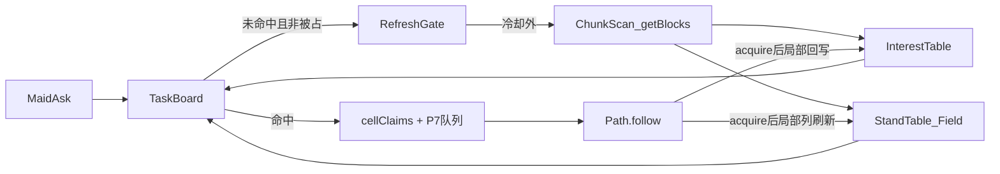

# 任务调度大改

## 基本任务

1、任务调度应该以可达场的视角进行。女仆在获取目标时，不应每次都遍历方块，而是让落脚点表、可达场自行扩展范围、更新方块信息和搜索目标。在女仆索要目标时直接从缓存中查找。
2、充分发挥 getBlocks 的性能优势：先排除空气，获取待查区域内全部方块的坐标集，然后在这个区域内进一步细化查询，减少 getBlock 获取方块详细信息的次数。

----

## 现状与痛点

### 调度入口

| 入口 | 频率 | 做什么 |
| --- | --- | --- |
| `MaidScheduleEvents.onTimer` → `MaidTarget.stepEvent` | 每步（约 3s） | 各工作 `onSchedulePulse`：卡住 job 兜底、空闲时 `collectTasks(claimRange)` 再派 |
| `MaidScheduleEvents.onTimer` → `MaidTarget.search(maid, 15)` | `healStep % 3`（约 9s） | 各工作 `search`：过 `SpeedController` 闸门后 `collectTasks` → `assignNext` |
| `onFollowComplete` | 每次跟随结束 | 队列空时再 `collectTasks` 续派 |

### 扫描开销

每次选目标都是**按女仆各自**重扫方块，同一块田多个女仆会重复扫描：

| 工作 | 扫描方式 | 每格开销 |
| --- | --- | --- |
| Farm | 按列 `getBlocks`（土地 + 成熟作物 permutation） | 每个命中位置再 `getBlock` 1～2 次（土地、上方作物） |
| 甘蔗 | 螺旋逐列 `getBlock` | 每列 3～6 次 |
| 瓜 | 螺旋逐列找瓜蒂 `getBlock` | 每列最多 3 次；读 `growth`、`facing_direction` 推瓜坐标 |
| 可可 | 螺旋逐列 `getBlock` | 每列 6 次（脚位 +4 到 -1） |

节流靠 `SpeedController` 的 `target_lack` 慢扫描：按女仆计数，与地形是否变化无关。空田里女仆照样定期全量扫描。

### 可达场只建不补

`StandField`：

- 落脚点只在 `scanChunk` → `createLeaf` 时新建；已扫完的层不再补新落脚点。
- 已有落脚点只在出发找路扩展到它时 `rereadLeaf`，只能删点、删边。
- 区块要闲置 `FIELD_CHUNK_IDLE_MS`（60s）**且**不在任何女仆活动圈内才 `discardIdle`；女仆在田里干活时区块永远不重建。

后果（瓜类堵路）：瓜长出后原地面落脚点失效，瓜顶新落脚点不入表；瓜被收后瓜顶落脚点失效，瓜下地面重新可站却不入表。场与地形长期对不上，表现为认领 `paused`/`unknown` 抖动、走廊被当成墙。

### 逐格读方块

`StandableCache.getFlags` 逐格 `getBlock`；建一个落脚点读支撑、脚、头 3 格，`isSunkSupportBlock` 每次都 `getBlock` 不走缓存。一个 16×16 区块建 3 层：同一缓存内去重后读 5 个高度约 1280 次，另加 `isSunkSupportBlock` 每格约 768 次，合计约 2000 次 `getBlock`。

----

## 总体架构

三层：

| 层 | 内容 | 生命周期 |
| --- | --- | --- |
| 区块缓存层 | 落脚点表、可达场、**兴趣点表** | 按 维度 → 区块 → 高度层 建；按区块卸载。三者共用一次 getBlocks 扫描结果 |
| 调度层 | **任务板**（TaskBoard）+ 刷新闸门（RefreshGate） | 进程内；女仆索要目标时只查缓存，套用 `cellClaims`、活动圈、同场判定，取最近 N 个 |
| 工作适配层 | Farm / 甘蔗 / 瓜 / 可可 | 只保留：兴趣点判定规则、`acquireAt`、兴趣点 → 落脚点映射。各自 `collectTasks`、`SpeedController` 退场 |



依赖方向：工作适配层只依赖任务板的抽象接口（注册兴趣点规则、`acquireAt`），不直接读落脚点表内部结构；任务板经 `StandField` 的导出函数（`classifyFieldClaim`、`reversiblePathResult` 等）问场，不碰 `DimRec`。

----

## 被区域指导的任务调度

落脚点表和可达场的 **更新条件** 需要改变。在女仆通过任务表找不到新目标（因为有其他女仆占用而找不到的情况除外）时，激活工作范围内 落脚点表等缓存数据 的更新，若这次更新没有找到新目标则等待一段时间再更新一次。两次更新之间需要存在较长的时间间隔（60s，即1200tick）。

### 范围

工作范围 = 女仆**活动圈**（家模式：家框 ±32；跟随：主人脚下 ±32；主人不在：女仆脚下 ±32），即 `activityCircleOf` 的方框。64×64 约 16 个区块（未对齐区块边界时最多 25 个）。getBlocks 优化后大范围处理效率提升，此开销可接受。

### 触发

- 女仆索要目标 → 任务板在缓存里找不到可派项。
- 区分「没有」和「被占」：候选存在但全部被其他女仆 `cellClaims` 占用 → **不触发**刷新，按现有空闲节奏等待。
- 候选存在但全部场不同/走不到（`different` / `unreachable`）→ 视为「没有」，可以触发（地形可能已变）。
- `unready`（层还没建完）→ 不触发，等建层预算跑完。

### 节流

- 两次刷新之间至少 **1200 tick**（建议值，改前请示）。
- 冷却按**活动圈覆盖的区块集合**记，不按女仆记：多个女仆在同一块田同时找不到目标时只刷新一次。
- 记录方式建议：每个区块记 `lastRefreshTick`；一次刷新请求只处理冷却外的区块。

### 刷新做什么

对范围内**已建**的层做 diff 重扫（已定方案 A，见「方案对比」；扫描流程见下文 getBlocks 一节）：

1. 新扫描得到的落脚点集合 vs 表里现有落脚点：
   - 新出现 → `createLeaf`（连边、按 `mergeRoot` 桥接合并）；
   - 消失 → `removeLeaf`（删边探测）；
   - 都在但邻居变了 → 走现有 `rereadLeaf` 的加边合并 / 删边探测分支。
2. 兴趣点同样 diff：增删候选。
3. 变动的边全部走现有合并与删边探测（P6 `mergeRoot` / prime / `afterMergeRescan`），场编号不整片重排。

范围内还没建的层按现有 `ensureStandHeight` 首建，不算刷新。

### 预算

沿用 `budgets.ts` 的「每拍上限、用尽只停这一件」：新增一份**刷新扫描预算**（每拍最多重扫多少个区块层），分到多个 tick 做完；未做完的区块层留在刷新队列里，冷却从该区块层实际做完时起算。

----

## 兴趣点表

新增一个概念：兴趣点表。和落脚点表同级，也是按区块缓存，按区块卸载。在构建落脚点表的同时也会构建兴趣点表。

属于落脚点表的子集的，可以在构建落脚点表时顺手标了：

+ farm：需要 1耕地 + 1作物（收割） 或 1空气（播种），是确定落脚点表的子集；
+ sugar_cane：需要 1落脚点 + 1甘蔗 + 1甘蔗，是确定落脚点表的子集；

不属于落脚点表的子集，需要看情况处理：

+ 可可豆：这类兴趣点的收集比较特殊，因为可可豆正下方不一定有落脚点。需要根据可可豆周围的情况分析。
+ 瓜类：充分发挥 getBlocks 查方块坐标的优势，不再检查瓜类是否连着瓜蒂，而是瓜类的旁边（四个方向）紧贴对应的瓜蒂就判定为可收获，免去getBlock的步骤。

### 数据模型

```
InterestPoint {
  kind: "farm_harvest" | "farm_plant" | "sugar_cane" | "melon" | "cocoa"
  pos: 动手的方块坐标（作物格 / 要砍的甘蔗节 / 瓜块 / 可可）
  standKeys: 可用落脚点的坐标键（1～多个）
  state: "candidate" | "ready"
  extra?: 可可 direction、补种作物 typeId 等
}
```

- 存放：维度 → 区块 → 层，与 `ChunkRec` 同生命周期；`discardIdle` 丢区块时一起清掉。
- 归属层：按 `pos` 所在区块与高度记；`standKeys` 可以跨区块。
- 认领：通过 `standKeys` 找到落脚点即得 `fieldId`，直接做同场判定，不必再按格子换算落脚点。

### 候选与就绪分两段

| 段 | 存什么 | 何时更新 |
| --- | --- | --- |
| 候选 candidate | 位置类型满足：作物格（任意生长阶段）、空耕地、甘蔗柱、瓜块、可可 | 建层、刷新 diff、`acquire` 后局部回写 |
| 就绪 ready | 候选里此刻可动手的：作物成熟、可可 age=2 等 | **查询时批量确认** |

就绪确认：把一批候选位置做成 `ListBlockVolume`，调用 `getBlocks(list, { includePermutations: 成熟态 })`，一次筛出就绪子集。作物长熟不改变方块类型，只改 permutation，所以**无需为了等作物长熟而重扫地形**；候选表只在地形 / 方块类型变化时才需要刷新。

### 各作物规则

| kind | 候选判定 | 落脚点 | 就绪判定 |
| --- | --- | --- | --- |
| farm_harvest | 落脚点是耕地（土地名单），上方是作物（`FarmBlocks` 作物类型） | 作物格下方的耕地（与现 `goalStandOfTask` 一致） | `includePermutations` = `FarmBlocks.getCorpPermutations()` |
| farm_plant | 落脚点是耕地，上方是空气 | 同上 | 查询时再对背包种子、补种冷却（`plantCooldown`）过滤 |
| sugar_cane | 落脚点上方连续 ≥2 节 `reeds`；动手格为土上方第 2 节（与现 `standDrop: 2` 一致） | 甘蔗根下方的土 | 候选即就绪（甘蔗长高后由刷新 diff 加入） |
| melon | `melon_block` / `pumpkin` 四邻紧贴对应瓜蒂（`melon_stem` / `pumpkin_stem`） | 瓜块四邻里可站的落脚点（含高低差 1、瓜顶） | 候选即就绪 |
| cocoa | `cocoa` 方块 | 附着原木外侧四邻与下方的可达落脚点（不要求正下方） | `includePermutations`：age=2，按 direction 0～3 各一条 |

说明：

- **瓜不查朝向的误判**（已确认接受）：旁边贴着瓜蒂、但该瓜蒂实际连着另一个瓜时也会判为可收。后果只是收掉一个本就成熟可收的瓜；省掉读 `growth` / `facing_direction` 的 `getBlock`。
- **可可朝向**：按 direction 0～3 分四次 `includePermutations` 查询，命中哪一组就记哪个 direction，补种无需 `getBlock`。
- **瓜的落脚点放宽**：不再只看四邻同高，四邻高低差 1 与瓜顶都算，缓解瓜挤满时找不到落脚点。

### 增量回写

女仆 `acquireAt` 成功后：

1. 本地删除或改写这条兴趣点（收割 → 删；Farm 收后补种 → 改为对应候选）。
2. 对动手格所在列及四邻做**局部列刷新**：重算这几列在已建层内的落脚点与兴趣点（diff 规则同上）。

局部列刷新同时解决瓜被收后的走廊问题：瓜下地面立即补进落脚点表并与两侧桥接合并。

----

## 使用 getBlocks 优化的扫描

拟定如下的扫描步骤：
+ 先排除空气，获取待查区域内全部方块的坐标集；

扫描单元：一个区块 16×16 × 请求的支撑层（现为 y-1..y+1），需要读的方块高度 y-1..y+3（支撑、脚、头）。

1. **非空气集合**：`getBlocks(vol, { excludeTypes: ["minecraft:air"] })` → 坐标集 `nonAir`。不在 `nonAir` 里的格即空气，直接当净空（passable、非支撑、非危险）。
2. **分组分类**：对同一 `vol` 用 `includeTypes` 再查若干次，把 `nonAir` 分组：
   - 薄片（植物、装饰）：可穿过、不支撑；
   - 危险：岩浆、火、岩浆块、水（按 `waterAsHazard`）；
   - 特殊：活板门、耕地、栅栏 / 墙、楼梯 / 梯子 / 脚手架、地毯、玻璃、树叶；
   - 各兴趣点类型：作物、土地、甘蔗、瓜 / 南瓜、瓜蒂、可可。

   名单唯一来源仍是 `blockPredicates.ts`。现在那里是 `includes` 子串匹配，需要提成可复用的导出名单（完整 typeId 列表）；子串规则无法直接喂给 `includeTypes` 的部分，在第 3 步逐格兜底。
3. **候选支撑与按需 getBlock**：
   - 候选支撑 = `nonAir` 中、上方两格均为空气或薄片的格。
   - 只对**候选支撑**与**特殊组里需要读状态的格**（如活板门 `open_bit` / `upside_down_bit`）调 `getBlock`。
   - 不依赖状态的 typeId，把 `evalBlockFlags` 结果按 typeId 缓存（进程内），同类型后续格不再 `getBlock`。
   - 脚 / 头格若在 `nonAir` 且不在薄片组 → 不可穿过，无需读。
4. **写表**：写落脚点与连边（复用 `reversibleSteps`，其底层取 flags 改为读本次扫描结果），同时按兴趣点规则挂上兴趣点候选。
5. **查询时确认就绪**：见兴趣点表「候选与就绪」。构建与就绪确认都不需要 `BlockQueryOptions` 的 `closest` / `location`，任务板按距离排序在脚本里做；之后设计若确实要用，再实测。
6. **需要实测的项**：
   - 跨未加载区块时 `allowUnloadedChunks: true` 的表现（只返回已加载部分）；
   - 基准：同一区块 3 层，旧路径 `getBlock` 次数 / 耗时 vs 新路径 `getBlocks` 次数 + `getBlock` 次数 / 耗时；含 `ListBlockVolume` 就绪确认的开销；
   - 计数方式参照 Phase0 探针归档做法，基准脚本测完归档，不常驻 BP。

   `getBlocks` 的体积 / 返回数量上限暂不预测：构建按「单区块 × 层」调用，体积小；以后若改成大体积合并调用再测。

----

## 与现有方案的关系

| 现有 | 关系 |
| --- | --- |
| P6 场合并传递闭包 | 刷新 diff、局部列刷新产生的合并全部沿用 `mergeRoot` / prime / `afterMergeRescan` |
| P7 认领 N + 队列 | 任务板直接产出最近 N 个就绪兴趣点；队列语义不变：每格都必须先 `Path.follow`，禁止 near 直收 |
| P7c 按列扫描 | 被兴趣点表替代；「按列更整齐」的分配体验在任务板排序里保留（同距按列序） |
| 瓜类堵路（之前讨论的方向 1：局部列刷新） | 由「acquire 后局部列刷新 + 60s 刷新 diff」解决；方向 2（放宽瓜落脚点）并入兴趣点规则 |
| `SpeedController` / `target_lack` | 退场：节流改由刷新闸门按区块冷却 |
| 各工作 `collectTasks` | 退场：改为向任务板注册兴趣点规则 |
| `StandableCache` | A* 等一次性搜索仍可保留逐格路径；`StandField` 建层改走 getBlocks 扫描 |

----

## 方案对比（刷新方式）

| 方案 | 做法 | 取舍 |
| --- | --- | --- |
| A（**已定**） | diff 重扫：新旧集合比对，增删落脚点 / 兴趣点，边变化走合并与删边探测 | 场编号稳定；实现中等 |
| B | 整层重建：丢掉层内落脚点重新 `createLeaf` | 实现简单；场编号大量变动，合并与探测开销大，认领短时间全部 `paused` |
| C | 只做 acquire 后局部列刷新 | 开销最小；覆盖不了自然生长（瓜长出、甘蔗长高）和玩家改地形 |

----

## 分期

| 阶段 | 内容 | 验收 |
| --- | --- | --- |
| P8a | getBlocks 扫描流水线替换 `StandField` 建层路径；`blockPredicates` 名单导出；性能基准 | 建层结果与旧路径一致（同一块地落脚点集合、场划分相同）；基准显示 `getBlock` 次数显著下降 |
| P8b | 兴趣点表 + 任务板，先接 Farm，替换 `Farm.collectTasks` | 同一块田两个女仆只扫一次；收割 / 补种行为与 P7 一致（逐格先 follow） |
| P8c | 刷新闸门（未命中且非被占才触发、按区块 1200 tick 冷却）、diff 刷新、acquire 后局部列刷新 | 空田 60s 内最多刷新一次；被占不触发刷新；收瓜后走廊立即可走 |
| P8d | 甘蔗、瓜、可可迁移到兴趣点规则；删除 `CropRoute` 的 `collect` 与 `SpeedController` | 三种工作行为与迁移前一致或更好；瓜挤满时仍能找到落脚点 |

----

## 风险

- **名单不全**：`includeTypes` 需要完整 typeId，子串规则覆盖的模组 / 新方块可能漏分组。第 3 步逐格兜底，名单缺项只影响性能不影响正确性。
- **候选过期**：玩家改地形、活塞、爆炸等在两次刷新之间改变方块，兴趣点可能指向已不存在的方块。不监听方块变化事件（见已拍板 4）；`acquireAt` 前已有方块校验，落脚点失效由找路时 `rereadLeaf` 兜底，其余靠 60s 刷新纠正。
- **冷却期内漏新目标**：作物被别人种下 / 长出新瓜，最长要等一次冷却才入表。就绪确认在查询时进行，只影响「新位置」，不影响「已知位置变成熟」。
- **大范围首建卡顿**：活动圈 ±32 约 16～25 个区块，首建与刷新都需按预算分拍。

----

## 已拍板

1. **刷新范围**：活动圈（±32，约 16 个区块）。getBlocks 优化后大范围处理效率提升，开销可接受。
2. **刷新方式**：A diff 重扫。
3. **瓜蒂不查朝向**：误判可接受。
4. **外部方块变更**：不订阅玩家放置 / 破坏事件。还有大量无法监听的方块变化（自然生长、活塞、爆炸、命令等），统一靠 60s 刷新兜底，不为部分来源单独打补丁。
5. **`getBlocks` 上限 / `closest`**：构建用不上，不预先实测；之后设计若需要再测。

## 待拍板

1. 常数（1200 tick、刷新扫描预算、N=5）均为建议值，改前请示。
